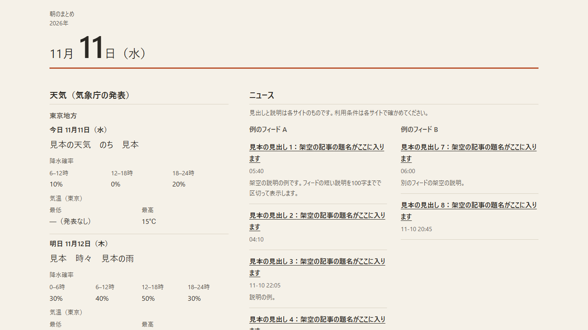
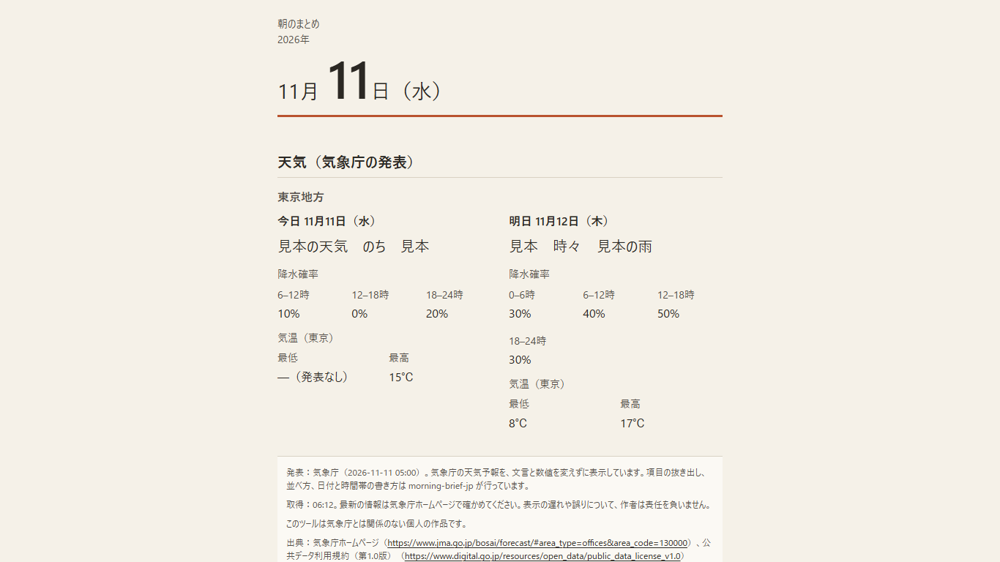

<div align="center">

# morning-brief-jp

**Your morning weather, calendar and news headlines on one HTML page — local only.**<br>
**朝の天気・予定・ニュースの見出しを、1枚の HTML に。手元だけで動きます。**

[](LICENSE)
[](package.json)
[](#english)
[](#english)
[](#about-the-weather-section)

[English](#english) · [日本語](#日本語)


<sub>Sample with made-up data. / 架空のデータで作った見本です。</sub>

</div>

---

<a id="english"></a>

## English

[日本語はこちら](#日本語)

A small tool that builds one HTML page for your morning: the weather (from the Japan Meteorological Agency), today's calendar events and the headlines you want to read. It runs only on your own PC and never sends your calendar URL or your list of feeds anywhere.

- This is an individual project, not affiliated with the Japan Meteorological Agency.
- The weather comes from data published on the JMA website. It is not an official API, so it **may stop working without notice**.
- **Tested on Windows only.** macOS and Linux are not tested.
- The page itself is in Japanese only.

### Features

- **Only the sections you set up appear.** An area code alone gives a weather-only page; add a calendar and feeds and more sections appear.
- **Weather as published.** Forecast text and numbers from the JMA website are shown unchanged. Probability of precipitation is shown per time slot as announced; no summary value is made up.
- **Today's events** from a private iCal address, including recurring events (complex recurrence rules may be missed).
- **News headlines** from any RSS or Atom feed: headline and a short description only (up to 100 characters), no article text.
- **One self-contained HTML file.** No JavaScript and no external images, fonts or scripts. Checked at a phone width of 390 px.
- **Gentle on the JMA server.** One forecast request per run, no refetch within 3 hours, and at most 4 fetches a day (see "About the weather section").

### Requirements

- Node.js 22 or later
- Tested on Windows. macOS and Linux should work but are **not tested**.

### Getting started

1. Get this repository (`git clone` or download the ZIP).
2. Run `npm install` in the folder.
3. Copy `config.example.json` to a new file named `config.json` (see "Copying the settings file" below).
4. Run `npm start`. The HTML is written to `out\morning-brief.html` in this folder, and the console prints 「朝のまとめを作りました：（place）」 (the brief was made, with its location). Double-click the file, or drag it into a browser.

With the copied settings as they are, you get a one-page Tokyo weather brief.

#### Copying the settings file

Either way gives the same result.

- File Explorer: select `config.example.json`, press Ctrl+C then Ctrl+V, and rename the copy to `config.json`. If you cannot see the `.json` extension, turn on "File name extensions" in the Explorer "View" menu first (to avoid ending up with `config.json.json`).
- Command Prompt: in this folder, run `copy config.example.json config.json`.

### Reading it on your phone every morning

This tool only writes an HTML file on your PC; it has no feature to send it to your phone. To read it on a phone, put the HTML in a place the phone can open yourself.

- Set `output.path` to a location inside a synced folder on your PC (OneDrive or similar, visible from a phone app) and the file is written there every time. Example: `"path": "C:/Users/<your-user-name>/OneDrive/morning-brief.html"` (you can use `/` as the separator; if you use `\`, write it twice, `\\`). Check the real location of the synced folder in Explorer.
- The generated HTML is one file with no JavaScript and no external loading (images, fonts, scripts). Moving that file elsewhere shows the same content. The layout is checked at a phone width of 390 px.
- **If you put it in a synced folder, an HTML file that contains your event titles and news headlines is stored by that cloud provider.** If you use the calendar, think about whether that is acceptable before you do this.
- How a phone app displays the HTML (opens it as is, or shows text only) differs by app, and is not tested here.

### Terms

| Term | Meaning |
|---|---|
| areaCode | A 6-digit number the JMA assigns to each prefecture or region. It decides which area's weather is shown (Tokyo is `130000`). See "Settings" below for how to find it. |
| iCal | A standard format for exporting calendar events. Google Calendar and others offer an address from which events can be read in this format. |
| RSS / Atom | Formats in which news sites distribute the headlines of new articles. Sites call it "RSS" or "feed". |
| Cache | Weather data fetched earlier and kept on your PC (the `.cache` folder here), so the JMA server is not asked again and again. |
| Announced (発表) | The time the JMA issued the forecast. Shown at the bottom of the page as 「発表：気象庁（date and time）」. When an earlier fetch is shown, it also appears in the line 「前回取得分：〜発表の予報です。」. |
| Fetched (取得) | The time this tool fetched the data from the JMA, shown at the bottom as 「取得：11:12」 (with month and day if it was the previous day). The fetch can be new while the announcement is still the old one. |

### Screenshots





All images are **samples.** The forecast text, events and headlines are made-up data, not real announcements or articles.

### Settings (config.json)

`config.json` is your own file. It is not committed to Git (it is in `.gitignore`).

| Key | Meaning |
|---|---|
| `weather.areaCode` | Required. The 6-digit number after `area_code=` in the address when you pick a region on the JMA forecast page (https://www.jma.go.jp/bosai/forecast/ ). Tokyo: `130000`. |
| `weather.areaName` | Name of the region to show (example: `東京地方`). If the name is not in the JMA data, the first region is shown and the console says so. |
| `weather.tempPointName` | Name of the point for temperatures (example: `東京`). If it does not exist, the first point is shown. |
| `schedule.enabled` | `true` shows the today's-events section. |
| `schedule.icalUrlEnv` | The **name of the environment variable** that holds the iCal URL (default `MORNING_BRIEF_ICAL_URL`). The URL itself is never written in the settings file. |
| `feeds[].name` / `feeds[].url` | Name and URL of a news feed (RSS or Atom). Entries with an empty URL are skipped. |
| `rss.sinceHour` | From what hour of the previous day to include articles (default 6). |
| `rss.visibleItemsPerFeed` | How many items are shown at first (default 4; the rest are inside the fold 「残り○件を見る」, "show N more"). |
| `rss.maxItemsPerFeed` | Upper limit of items taken from one feed (default 10). |
| `output.path` | Output location (default `./out/morning-brief.html`, relative to the settings file's folder). |
| `timezone` | Time zone for dates and times (default `Asia/Tokyo`). |

To use settings from another place, run `node bin/morning-brief.mjs --config <path-to-settings-file>`. `node bin/morning-brief.mjs --help` shows usage (nothing is fetched then).

#### Adding your calendar (iCal)

1. Copy your calendar's private iCal address. In Google Calendar, on a PC browser: "Settings", pick the calendar in the left list, "Integrate calendar", "Secret address in iCal format". **This address works like a password.** Do not show it to anyone or write it in a file you publish.
2. In Windows: "Advanced system settings", "Environment Variables", then "New" under user variables. Name: `MORNING_BRIEF_ICAL_URL`; value: the copied address. (Entering it from this screen is recommended so it does not stay in your command history.)
3. Set `schedule.enabled` to `true` in `config.json`.
4. **Close any open Command Prompt or terminal and open a new one**, then run `npm start`. Environment variables do not reach windows opened before you set them.

- The address is never shown on the page or in the console. Events are not cached.
- Recurrences, excluded dates and changed single occurrences are expanded with a parsing library (ical.js), but complex recurrences can be missed.
- Events whose time zone definition is missing from the file are skipped, and the section says 「一部の予定を読めませんでした。」 (some events could not be read).

#### Adding news (RSS)

- Write a name and a URL in `feeds`. No default feeds are included.
- Only the headline and a short description (up to 100 characters) are used; the article body is not fetched.
- **Check each site's terms of use yourself.**
- To find a feed URL: look for the "RSS" or "feed" link on the site you want to read and copy its address. For example, these pages have lists (listing them here does not mean you may use them; check the terms on each page):
    - [NHK News RSS list](https://www.nhk.or.jp/toppage/rss/index.html)
    - [ITmedia RSS list](https://corp.itmedia.co.jp/media/rss_list/)
    - [Yahoo! News RSS list](https://news.yahoo.co.jp/rss)
- Example: put `{ "name": "(any name)", "url": "(the copied address)" }` entries inside `feeds`.

### About the weather section

- Forecast text and numbers from the JMA website are shown unchanged. This tool only picks out the items, orders them, and writes the dates and time slots.
- Probability of precipitation is shown per announced time slot as is; no combined value is made up. Items that were not announced show 「—（発表なし）」.
- In a forecast issued that day, today's minimum temperature is not shown (it shows 「—（発表なし）」). When an earlier fetch shows the previous day's forecast, that forecast's values are shown.
- Warnings and advisories, and advice on umbrellas or clothing, are not shown. The emoji icons on headings and labels are decoration and do not represent forecast content.
- One run fetches one forecast JSON. Within 3 hours of the previous fetch it is not fetched again, and there are at most 4 fetches a day (one retry after 60 seconds on failure counts as part of the same fetch). Because "4 a day" counts one fetch with its retry as one, repeated failures can push the actual requests to the JMA above 4 (at most 7 including the first area-list fetch). When a fetch fails, the previous fetch from within 24 hours of its announcement is shown, with the line 「前回取得分：〜発表の予報です。」.
- The weather comes from data published on the JMA website. It is not an official API, so it may stop working without notice.
- This tool is an individual project, not affiliated with the JMA. Source: JMA website (https://www.jma.go.jp/bosai/forecast/ ), Public Data License (version 1.0) (https://www.digital.go.jp/resources/open_data/public_data_license_v1.0 ).

### Running it every morning (Windows Task Scheduler example)

1. In "Task Scheduler", choose "Create Basic Task".
2. Trigger: "Daily", at **any minute in the 6 o'clock hour** (example: 6:17). Avoid exactly on the hour so fetches to the JMA do not bunch up.
3. Action: "Start a program". Program: the location of `node.exe`; arguments: `bin\morning-brief.mjs`; "Start in": this repository's folder.

Run `where node` in Command Prompt to find `node.exe` (example: `C:\Program Files\nodejs\node.exe`). In PowerShell, `where` is a different command, so type `where.exe node`.

The generated HTML is not opened automatically. Open it in a browser in the morning.

### Tests

```
npm test
```

No network is used; it runs on made-up data. Sample pages can be written to `out/samples/` with `node scripts/render-samples.mjs`.

### Dependencies

- [fast-xml-parser](https://github.com/NaturalIntelligence/fast-xml-parser) 5.12.0 (MIT): reads RSS and Atom
- [ical.js](https://github.com/kewisch/ical.js) 2.2.1 (MPL-2.0): reads iCal and expands recurrences

### License

MIT (`LICENSE`)

---

<a id="日本語"></a>

## 日本語

[English](#english)

朝に、天気（気象庁の発表）、今日の予定、読みたいニュースの見出しを、1枚の HTML で見るための道具です。自分の PC だけで動き、予定の URL や読むフィードの一覧を外へ送りません。

- 気象庁とは関係のない個人の作品です
- 天気は気象庁ホームページで公開されているデータを使っています。公式の API ではないため、**予告なく使えなくなることがあります**
- **Windows でだけ動作を確かめています。** macOS と Linux は確かめていません

### 特徴

- **設定した欄だけが出ます。** 地域コードだけなら天気だけ、予定とフィードを入れれば欄が増えます。
- **天気は発表のまま。** 気象庁ホームページの予報の文と数値を変えずに出し、降水確率は発表された時間帯ごとにそのまま出します（まとめた値は作りません）。
- **今日の予定**：非公開の iCal のアドレスから読みます。繰り返しの予定も展開します（複雑な繰り返しは取りこぼすことがあります）。
- **ニュースの見出し**：好きな RSS / Atom から、見出しと短い説明（100字まで）だけを取ります。本文は取りません。
- **1ファイルの HTML。** JavaScript も外部の画像・フォント・スクリプトも含みません。スマホの幅（390px）で確かめています。
- **気象庁のサーバーに優しく。** 1回の実行で予報を1本だけ取り、3時間以内は取り直さず、1日4回までです（「天気の欄について」を参照）。

### 必要なもの

- Node.js 22 以上
- Windows で動作を確かめています。macOS と Linux は動くはずですが、**確かめていません**

### はじめかた

1. このリポジトリを取得する（`git clone` か ZIP のダウンロード）
2. フォルダの中で `npm install` を実行する
3. `config.example.json` をコピーして、`config.json` という名前にする（下の「設定ファイルのコピー」）
4. `npm start` を実行する。できた HTML は、このフォルダの中の `out\morning-brief.html` です。コンソールにも「朝のまとめを作りました：（場所）」と出ます。このファイルをダブルクリックするか、ブラウザに引っぱって開きます

コピーした設定のままなら、東京の天気だけの1枚ができます。

#### 設定ファイルのコピー

どちらの方法でも同じです。

- エクスプローラー：`config.example.json` を選んで Ctrl+C、Ctrl+V で複製し、できたファイルの名前を `config.json` に変える。拡張子（`.json`）が見えていないときは、エクスプローラーの「表示」→「表示」→「ファイル名拡張子」で見えるようにしてから変えてください（`config.json.json` になるのを防ぐため）
- コマンドプロンプト：このフォルダで `copy config.example.json config.json`

### 毎朝スマホで見るには

この道具は HTML を PC に書き出すだけで、スマホへ送る機能はありません。スマホで見るには、自分で HTML をスマホから開ける場所に置きます。

- 設定の `output.path` に、PC の同期フォルダ（OneDrive など、スマホのアプリからも見えるフォルダ）の中の場所を書けば、毎回そこへ書き出されます。例：`"path": "C:/Users/<自分のユーザー名>/OneDrive/morning-brief.html"`（区切りは `/` で書けます。`\` を使うときは `\\` と2つ重ねます）。同期フォルダの実際の場所は、エクスプローラーで確かめてください
- できる HTML は1ファイルで、JavaScript も外部の読み込み（画像、フォント、スクリプト）も含みません。そのファイルだけを別の場所へ置いても、同じ内容が出ます。画面はスマホの幅（390px）で確かめています
- **同期フォルダに置くと、予定の件名やニュースの見出しを含む HTML が、そのクラウドの事業者に保存されます。** 予定を入れているときは、それでよいか考えてから使ってください
- スマホのアプリで HTML がどう表示されるか（そのまま開けるか、文字だけになるか）は、アプリによって違い、この作品では確かめていません

### ことばの説明

| ことば | 意味 |
|---|---|
| areaCode（地域コード） | 気象庁が都道府県などの地域に付けている6桁の番号。どの地域の天気を出すかを決めます（東京都は `130000`）。調べ方は下の「設定」 |
| iCal | カレンダーの予定を書き出す決まった形式。Google カレンダーなどが、予定をこの形式で読めるアドレスを用意しています |
| RSS / Atom | ニュースサイトなどが新しい記事の見出しを配る形式。サイトによって「RSS」「フィード」と書かれています |
| キャッシュ | 前に取った天気のデータを PC に取っておいたもの（このフォルダの `.cache`）。気象庁へ何度も取りに行かないために使います |
| 発表 | 気象庁が予報を出した時刻。画面の下の「発表：気象庁（日時）」に出ます。前回取得分を出すときは「前回取得分：〜発表の予報です。」の行にも出ます |
| 取得 | この道具が気象庁からデータを取ってきた時刻。画面の下の「取得：11:12」に出ます（前日のときは月日つき）。取得が新しくても、発表は前のままのことがあります |

### 画面

- 画面は日本語のみです


画像はすべて**見本の画面です。** 天気の文、予定、見出しは架空のデータで、実際の発表や記事ではありません。

### 設定（config.json）

`config.json` は自分用のファイルです。Git には入りません（`.gitignore` 済み）。

| 項目 | 意味 |
|---|---|
| `weather.areaCode` | 必須。気象庁の天気予報のページ（https://www.jma.go.jp/bosai/forecast/ ）で地域を選んだときの、アドレスの `area_code=` の6桁の数字（東京都の例：`130000`） |
| `weather.areaName` | 出す地方の名前（例：`東京地方`）。気象庁のデータに無い名前なら先頭の地方を出し、コンソールで知らせます |
| `weather.tempPointName` | 気温を出す地点の名前（例：`東京`）。無い名前なら先頭の地点を出します |
| `schedule.enabled` | `true` で今日の予定の欄を出します |
| `schedule.icalUrlEnv` | iCal の URL を入れた**環境変数の名前**（既定 `MORNING_BRIEF_ICAL_URL`）。URL そのものは設定ファイルに書きません |
| `feeds[].name` / `feeds[].url` | ニュースのフィードの名前と、RSS または Atom の URL。URL が空のものは飛ばします |
| `rss.sinceHour` | 前日の何時以降の記事を出すか（既定 6） |
| `rss.visibleItemsPerFeed` | 最初から見せる件数（既定 4。残りは「残り○件を見る」の中） |
| `rss.maxItemsPerFeed` | 1つのフィードから取り込む件数の上限（既定 10） |
| `output.path` | 出力先（既定 `./out/morning-brief.html`。設定ファイルのフォルダが基準） |
| `timezone` | 日付と時刻の地域（既定 `Asia/Tokyo`） |

別の場所の設定を使うときは `node bin/morning-brief.mjs --config <設定ファイルのパス>` で動かします。使い方は `node bin/morning-brief.mjs --help` で出ます（このときは取得しません）。

#### 予定（iCal）を足す

1. カレンダーの「非公開の iCal 形式のアドレス」をコピーする。Google カレンダーでは、PC のブラウザで「設定」→ 左の一覧で対象のカレンダー →「カレンダーの統合」→「iCal 形式の非公開アドレス」にあります。**このアドレスは合言葉と同じです。** 人に見せたり、ファイルに書いて公開したりしないでください
2. Windows の「システムの詳細設定」→「環境変数」→ ユーザー環境変数の「新規」で、名前を `MORNING_BRIEF_ICAL_URL`、値をコピーしたアドレスにする（コマンドの履歴に残さないため、この画面から入れることを勧めます）
3. `config.json` の `schedule.enabled` を `true` にする
4. **開いていたコマンドプロンプトやターミナルは閉じて、開き直してから** `npm start` を実行する。環境変数は、設定より前に開いていた画面には伝わりません

- アドレスは画面にもコンソールにも出しません。予定はキャッシュしません
- 繰り返し、除外日、一部だけ変えた回は読み取りの部品（ical.js）で展開しますが、複雑な繰り返しは取りこぼすことがあります
- 時間帯の定義がファイルの中に無い予定は飛ばし、欄に「一部の予定を読めませんでした。」と出します

#### ニュース（RSS）を足す

- `feeds` に名前と URL を書きます。既定のフィードは入っていません
- 使うのは見出しと短い説明（100字まで）だけで、本文は取りません
- **各サイトの利用条件は、使う人が自分で確かめてください。**
- フィードの URL の探し方：読みたいサイトの「RSS」「フィード」のリンクを探して、そのアドレスをコピーします。たとえば、次のページに一覧があります（ここに載せるのは一覧のページで、使ってよいという意味ではありません。利用条件は各ページで確かめてください）
    - [NHK ニュースの RSS 一覧](https://www.nhk.or.jp/toppage/rss/index.html)
    - [ITmedia の RSS 一覧](https://corp.itmedia.co.jp/media/rss_list/)
    - [Yahoo!ニュースの RSS 一覧](https://news.yahoo.co.jp/rss)
- 設定の例：`{ "name": "（好きな名前）", "url": "（コピーしたアドレス）" }` を `feeds` の中に並べます

### 天気の欄について

- 気象庁ホームページの天気予報の文と数値を、変えずに表示します。項目の抜き出し、並べ方、日付と時間帯の書き方だけをこの道具が行います
- 降水確率は発表された時間帯ごとにそのまま出し、まとめた値は作りません。発表の無い項目は「—（発表なし）」と出します
- その日に出た発表では、今日の最低気温は表示しません（「—（発表なし）」と出ます）。前回取得分で前日の発表を出すときは、その発表の値を出します
- 警報・注意報、傘や服装の助言は出しません。見出しとラベルの絵文字アイコンは飾りで、予報の内容を表しません
- 取得は1回の実行で予報の JSON を1本だけです。前の取得から3時間以内なら取り直さず、1日の取得は4回までです（取れなかったときの60秒後の再試行1回は、同じ取得の一部として数えます）。この「1日4回」は再試行込みの取得1回を1と数えるため、取れない回が続くと、気象庁への実際の送信は4回を超えることがあります（初回の地域一覧の取得を含めて最大7回）。取れなかったときは、発表から24時間以内の前回取得分を「前回取得分：〜発表の予報です。」の行をつけて出します
- 天気は気象庁ホームページで公開されているデータを使っています。公式の API ではないため、予告なく使えなくなることがあります。
- このツールは気象庁とは関係のない個人の作品です。出典：気象庁ホームページ（https://www.jma.go.jp/bosai/forecast/ ）、公共データ利用規約（第1.0版）（https://www.digital.go.jp/resources/open_data/public_data_license_v1.0 ）

### 毎朝の自動実行（Windows のタスクスケジューラの例）

1. 「タスク スケジューラ」で「基本タスクの作成」を選ぶ
2. トリガーは「毎日」、時刻は **6時台の好きな分**（例：6時17分）にする。気象庁への取得が集中しないよう、正時ちょうどは避けてください
3. 操作は「プログラムの開始」。プログラムに `node.exe` の場所、引数に `bin\morning-brief.mjs`、開始（オプション）に、このリポジトリのフォルダを入れる

`node.exe` の場所は、コマンドプロンプトで `where node` と打つと出ます（例：`C:\Program Files\nodejs\node.exe`）。PowerShell では `where` が別の命令になるので、`where.exe node` と打ちます。

できた HTML は自動では開きません。朝にブラウザで開いてください。

### テスト

```
npm test
```

通信はせず、架空のデータで動きます。見本の画面は `node scripts/render-samples.mjs` で `out/samples/` に書き出せます。

### 依存

- [fast-xml-parser](https://github.com/NaturalIntelligence/fast-xml-parser) 5.12.0（MIT）：RSS と Atom の読み取り
- [ical.js](https://github.com/kewisch/ical.js) 2.2.1（MPL-2.0）：iCal の読み取りと繰り返しの展開

### ライセンス

MIT（`LICENSE`）
