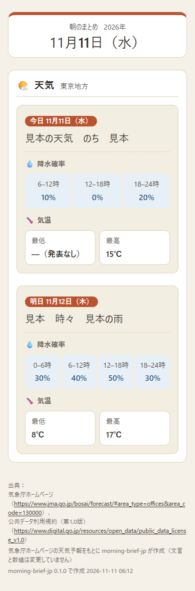

# morning-brief-jp



朝に、天気（気象庁の発表）、今日の予定、読みたいニュースの見出しを、1枚の HTML で見るための道具です。自分の PC だけで動き、予定の URL や読むフィードの一覧を外へ送りません。

- 天気は気象庁ホームページで公開されているデータを使っています。公式の API ではないため、**予告なく使えなくなることがあります**
- **Windows でだけ動作を確かめています。** macOS と Linux は確かめていません

## はじめかた

1. このリポジトリを取得する（`git clone` か ZIP のダウンロード）
2. フォルダの中で `npm install` を実行する
3. `config.example.json` をコピーして、`config.json` という名前にする（下の「設定ファイルのコピー」）
4. `npm start` を実行する。できた HTML は、このフォルダの中の `out\morning-brief.html` です。コンソールにも「朝のまとめを作りました：（場所）」と出ます。このファイルをダブルクリックするか、ブラウザに引っぱって開きます

コピーした設定のままなら、東京の天気だけの1枚ができます。

### 設定ファイルのコピー

どちらの方法でも同じです。

- エクスプローラー：`config.example.json` を選んで Ctrl+C、Ctrl+V で複製し、できたファイルの名前を `config.json` に変える。拡張子（`.json`）が見えていないときは、エクスプローラーの「表示」→「表示」→「ファイル名拡張子」で見えるようにしてから変えてください（`config.json.json` になるのを防ぐため）
- コマンドプロンプト：このフォルダで `copy config.example.json config.json`

## 毎朝スマホで見るには

この道具は HTML を PC に書き出すだけで、スマホへ送る機能はありません。スマホで見るには、自分で HTML をスマホから開ける場所に置きます。

- 設定の `output.path` に、PC の同期フォルダ（OneDrive など、スマホのアプリからも見えるフォルダ）の中の場所を書けば、毎回そこへ書き出されます。例：`"path": "C:/Users/<自分のユーザー名>/OneDrive/morning-brief.html"`（区切りは `/` で書けます。`\` を使うときは `\\` と2つ重ねます）。同期フォルダの実際の場所は、エクスプローラーで確かめてください
- できる HTML は1ファイルで、JavaScript も外部の読み込み（画像、フォント、スクリプト）も含みません。そのファイルだけを別の場所へ置いても、同じ内容が出ます。画面はスマホの幅（390px）で確かめています
- **同期フォルダに置くと、予定の件名やニュースの見出しを含む HTML が、そのクラウドの事業者に保存されます。** 予定を入れているときは、それでよいか考えてから使ってください
- スマホのアプリで HTML がどう表示されるか（そのまま開けるか、文字だけになるか）は、アプリによって違い、この作品では確かめていません

## ことばの説明

| ことば | 意味 |
|---|---|
| areaCode（地域コード） | 気象庁が都道府県などの地域に付けている6桁の番号。どの地域の天気を出すかを決めます（東京都は `130000`）。調べ方は下の「設定」 |
| iCal | カレンダーの予定を書き出す決まった形式。Google カレンダーなどが、予定をこの形式で読めるアドレスを用意しています |
| RSS / Atom | ニュースサイトなどが新しい記事の見出しを配る形式。サイトによって「RSS」「フィード」と書かれています |
| キャッシュ | 前に取った天気のデータを PC に取っておいたもの（このフォルダの `.cache`）。気象庁へ何度も取りに行かないために使います |
| 発表 | 気象庁が予報を出した時刻。前回取得分を出すときだけ、「前回取得分：〜発表の予報です。」の行に出ます |
| 取得 | この道具が気象庁からデータを取ってきた時刻。画面には出しません（取得が新しくても、発表は前のままのことがあります） |

---

- 設定した欄だけが出ます。地域コードだけなら天気だけ、予定とフィードを入れれば欄が増えます
- 画面は日本語のみです


画像はすべて**見本の画面です。** 天気の文、予定、見出しは架空のデータで、実際の発表や記事ではありません。

## 必要なもの

- Node.js 22 以上
- Windows で動作を確かめています。macOS と Linux は動くはずですが、**確かめていません**

## 設定（config.json）

`config.json` は自分用のファイルです。Git には入りません（`.gitignore` 済み）。

| 項目 | 意味 |
|---|---|
| `weather.areaCode` | 必須。気象庁の天気予報のページ（https://www.jma.go.jp/bosai/forecast/ ）で地域を選んだときの、アドレスの `area_code=` の6桁の数字（東京都の例：`130000`） |
| `weather.areaName` | 出す地方の名前（例：`東京地方`）。気象庁のデータに無い名前なら先頭の地方を出し、コンソールで知らせます |
| `weather.tempPointName` | 気温を出す地点の名前（例：`東京`）。無い名前なら先頭の地点を出します |
| `schedule.enabled` | `true` で今日の予定の欄を出します |
| `schedule.icalUrlEnv` | iCal の URL を入れた**環境変数の名前**（既定 `MORNING_BRIEF_ICAL_URL`）。URL そのものは設定ファイルに書きません |
| `feeds[].name` / `feeds[].url` | ニュースのフィードの名前と、RSS または Atom の URL。URL が空のものは飛ばします |
| `rss.sinceHour` | 前日の何時以降の記事を出すか（既定 6） |
| `rss.visibleItemsPerFeed` | 最初から見せる件数（既定 4。残りは「残り○件を見る」の中） |
| `rss.maxItemsPerFeed` | 1つのフィードから取り込む件数の上限（既定 10） |
| `output.path` | 出力先（既定 `./out/morning-brief.html`。設定ファイルのフォルダが基準） |
| `timezone` | 日付と時刻の地域（既定 `Asia/Tokyo`） |

別の場所の設定を使うときは `node bin/morning-brief.mjs --config <設定ファイルのパス>` で動かします。使い方は `node bin/morning-brief.mjs --help` で出ます（このときは取得しません）。

### 予定（iCal）を足す

1. カレンダーの「非公開の iCal 形式のアドレス」をコピーする。Google カレンダーでは、PC のブラウザで「設定」→ 左の一覧で対象のカレンダー →「カレンダーの統合」→「iCal 形式の非公開アドレス」にあります。**このアドレスは合言葉と同じです。** 人に見せたり、ファイルに書いて公開したりしないでください
2. Windows の「システムの詳細設定」→「環境変数」→ ユーザー環境変数の「新規」で、名前を `MORNING_BRIEF_ICAL_URL`、値をコピーしたアドレスにする（コマンドの履歴に残さないため、この画面から入れることを勧めます）
3. `config.json` の `schedule.enabled` を `true` にする
4. **開いていたコマンドプロンプトやターミナルは閉じて、開き直してから** `npm start` を実行する。環境変数は、設定より前に開いていた画面には伝わりません

- アドレスは画面にもコンソールにも出しません。予定はキャッシュしません
- 繰り返し、除外日、一部だけ変えた回は読み取りの部品（ical.js）で展開しますが、複雑な繰り返しは取りこぼすことがあります
- 時間帯の定義がファイルの中に無い予定は飛ばし、欄に「一部の予定を読めませんでした。」と出します

### ニュース（RSS）を足す

- `feeds` に名前と URL を書きます。既定のフィードは入っていません
- 使うのは見出しと短い説明（100字まで）だけで、本文は取りません
- **各サイトの利用条件は、使う人が自分で確かめてください。**

## 天気の欄について

- 気象庁ホームページの天気予報の文と数値を、変えずに表示します。項目の抜き出し、並べ方、日付と時間帯の書き方だけをこの道具が行います
- 降水確率は発表された時間帯ごとにそのまま出し、まとめた値は作りません。発表の無い項目は「—（発表なし）」と出します
- その日に出た発表では、今日の最低気温は表示しません（「—（発表なし）」と出ます）。前回取得分で前日の発表を出すときは、その発表の値を出します
- アイコン、警報・注意報、傘や服装の助言は出しません
- 取得は1回の実行で予報の JSON を1本だけです。前の取得から3時間以内なら取り直さず、1日の取得は4回までです（取れなかったときの60秒後の再試行1回は、同じ取得の一部として数えます）。この「1日4回」は再試行込みの取得1回を1と数えるため、取れない回が続くと、気象庁への実際の送信は4回を超えることがあります（初回の地域一覧の取得を含めて最大7回）。取れなかったときは、発表から24時間以内の前回取得分を「前回取得分：〜発表の予報です。」の行をつけて出します
- 天気は気象庁ホームページで公開されているデータを使っています。公式の API ではないため、予告なく使えなくなることがあります。
- このツールは気象庁とは関係のない個人の作品です。出典：気象庁ホームページ、公共データ利用規約（第1.0版）

## 毎朝の自動実行（Windows のタスクスケジューラの例）

1. 「タスク スケジューラ」で「基本タスクの作成」を選ぶ
2. トリガーは「毎日」、時刻は **6時台の好きな分**（例：6時17分）にする。気象庁への取得が集中しないよう、正時ちょうどは避けてください
3. 操作は「プログラムの開始」。プログラムに `node.exe` の場所、引数に `bin\morning-brief.mjs`、開始（オプション）に、このリポジトリのフォルダを入れる

`node.exe` の場所は、コマンドプロンプトで `where node` と打つと出ます（例：`C:\Program Files\nodejs\node.exe`）。PowerShell では `where` が別の命令になるので、`where.exe node` と打ちます。

できた HTML は自動では開きません。朝にブラウザで開いてください。

## テスト

```
npm test
```

通信はせず、架空のデータで動きます。見本の画面は `node scripts/render-samples.mjs` で `out/samples/` に書き出せます。

## 依存

- [fast-xml-parser](https://github.com/NaturalIntelligence/fast-xml-parser) 5.12.0（MIT）：RSS と Atom の読み取り
- [ical.js](https://github.com/kewisch/ical.js) 2.2.1（MPL-2.0）：iCal の読み取りと繰り返しの展開

## ライセンス

MIT（`LICENSE`）
